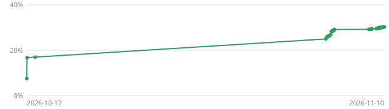

# Progress

**31.93%** of `Tornado.exe`'s code matches byte for byte: 733.8 KB of 2.24 MB, 5,475 of 14,947 functions, 139 units complete.

| | | Matched | Code | Functions |
|---|---|---:|---:|---:|
| All code | `██████░░░░░░░░░░░░░░` | 31.93% | 733.8 KB / 2.24 MB | 5,475 / 14,947 |
| Game and engine | `███████░░░░░░░░░░░░░` | 33.29% | 388.4 KB / 1.14 MB | 4,225 / 6,438 |
| Libraries | `█████████████████░░░` | 86.91% | 342.1 KB / 393.6 KB | 1,238 / 1,282 |
| C/C++ runtime | `░░░░░░░░░░░░░░░░░░░░` | 0.00% | 0.0 KB / 155.3 KB | 0 / 713 |
| SDK libraries | `░░░░░░░░░░░░░░░░░░░░` | 0.57% | 3.3 KB / 582.5 KB | 12 / 6,514 |

## Over time

## Units

268 units with source

| Unit | Code | Matched | Complete |
|---|---:|---:|---|
| `Tongas2/ACTOR` | 23.0 KB | 53.32% |  |
| `Tongas2/ACTORLINK` | 2.1 KB | 100.00% | yes |
| `Tongas2/ACTORRESOURCES` | 2.5 KB | 100.00% | yes |
| `Tongas2/ANIMATEDGEOMETRY` | 14.0 KB | 0.19% |  |
| `Tongas2/APP` | 1.4 KB | 81.97% |  |
| `Tongas2/APPOPTIONS` | 1.2 KB | 100.00% | yes |
| `Tongas2/APPWINDOW` | 2.1 KB | 100.00% | yes |
| `Tongas2/B2PATH` | 1.1 KB | 78.42% |  |
| `Tongas2/BEHAVIORFADERESLOOP` | 0.1 KB | 100.00% | yes |
| `Tongas2/BEHAVIORGROW` | 0.2 KB | 100.00% | yes |
| `Tongas2/BEHAVIORGROWLOOP` | 0.1 KB | 100.00% | yes |
| `Tongas2/BEHAVIORGROWRESLOOP` | 0.2 KB | 100.00% | yes |
| `Tongas2/BONEDMODEL` | 2.2 KB | 100.00% | yes |
| `Tongas2/BONEDMODELDX8SD` | 11.5 KB | 23.50% |  |
| `Tongas2/CAMERA` | 6.2 KB | 65.93% |  |
| `Tongas2/CANIMATEDMESH` | 7.5 KB | 0.00% |  |
| `Tongas2/CMDBASE` | 20.6 KB | 29.15% |  |
| `Tongas2/CMDMGR` | 7.9 KB | 54.85% |  |
| `Tongas2/COLLISIONSCENEDX8SD` | 1.2 KB | 23.52% |  |
| `Tongas2/CONSOLE` | 3.1 KB | 79.77% |  |
| `Tongas2/CPRIMITIVE3` | 10.7 KB | 50.63% |  |
| `Tongas2/CURVE` | 4.0 KB | 61.83% |  |
| `Tongas2/D3DAPP` | 10.1 KB | 1.64% |  |
| `Tongas2/DECAL` | 7.2 KB | 66.27% |  |
| `Tongas2/DISTSEGBOX` | 4.2 KB | 30.23% |  |
| `Tongas2/DRM` | 0.5 KB | 100.00% | yes |
| `Tongas2/DX8APP` | 9.4 KB | 4.08% |  |
| `Tongas2/DXINPUT` | 3.8 KB | 100.00% | yes |
| `Tongas2/DXVERSION` | 2.6 KB | 0.00% |  |
| `Tongas2/EMITTER` | 23.3 KB | 17.00% |  |
| `Tongas2/FILELOADER` | 0.6 KB | 100.00% | yes |
| `Tongas2/FILELOADERWKZ` | 0.9 KB | 100.00% | yes |
| `Tongas2/FX` | 9.3 KB | 67.29% |  |
| `Tongas2/GAME` | 0.8 KB | 100.00% | yes |
| `Tongas2/GAMECORE1` | 73.5 KB | 16.81% |  |
| `Tongas2/GAMECORE2` | 84.8 KB | 13.29% |  |
| `Tongas2/GAMECORE3` | 76.2 KB | 9.14% |  |
| `Tongas2/GAMECORE4` | 65.3 KB | 12.78% |  |
| `Tongas2/GEOMETRY` | 20.2 KB | 30.99% |  |
| `Tongas2/GLOBALDEFS` | 0.8 KB | 100.00% | yes |
| `Tongas2/GUI` | 8.4 KB | 95.02% |  |
| `Tongas2/GUIBEHAVIOR` | 0.7 KB | 100.00% | yes |
| `Tongas2/GUIBEHAVIORS` | 13.2 KB | 83.11% |  |
| `Tongas2/GUIBLINK` | 0.7 KB | 85.59% |  |
| `Tongas2/GUICHECKBOX` | 1.0 KB | 100.00% | yes |
| `Tongas2/GUICHECKBOXCONTROL` | 0.8 KB | 100.00% | yes |
| `Tongas2/GUICHECKGROUP` | 0.8 KB | 100.00% | yes |
| `Tongas2/GUICHECKGROUPCONTROL` | 0.8 KB | 100.00% | yes |
| `Tongas2/GUICONTROL` | 3.2 KB | 84.12% |  |
| `Tongas2/GUIFADE` | 0.4 KB | 77.11% |  |
| `Tongas2/GUIGENERIC` | 2.8 KB | 100.00% | yes |
| `Tongas2/GUIGENERICCONTROL` | 6.6 KB | 46.77% |  |
| `Tongas2/GUIGROUP` | 4.9 KB | 100.00% | yes |
| `Tongas2/GUIGROUPCONTROL` | 10.4 KB | 74.55% |  |
| `Tongas2/GUIJITTER` | 0.9 KB | 84.23% |  |
| `Tongas2/GUISIZE` | 0.7 KB | 11.32% |  |
| `Tongas2/GUISLIDER` | 2.0 KB | 100.00% | yes |
| `Tongas2/GUISLIDERCONTROL` | 1.7 KB | 61.17% |  |
| `Tongas2/GUITEXT` | 4.0 KB | 49.67% |  |
| `Tongas2/GUITEXTCONTROL` | 6.8 KB | 42.14% |  |
| `Tongas2/GUITEXTEDIT` | 2.6 KB | 100.00% |  |
| `Tongas2/GUITEXTEDITCONTROL` | 2.9 KB | 84.35% |  |
| `Tongas2/GUIVISUAL` | 3.9 KB | 74.05% |  |
| `Tongas2/GUIVISUALCONTROL` | 6.6 KB | 44.75% |  |
| `Tongas2/HARDWARE` | 4.9 KB | 2.37% |  |
| `Tongas2/HEIGHTMAPDECALDX8` | 7.2 KB | 44.99% |  |
| `Tongas2/HEIGHTMAPDX8` | 29.0 KB | 27.46% |  |
| `Tongas2/INPUT` | 4.3 KB | 100.00% | yes |
| `Tongas2/INTRO` | 4.7 KB | 27.14% |  |
| `Tongas2/KERNELCOMMANDS` | 18.5 KB | 44.21% |  |
| `Tongas2/LIGHT` | 2.2 KB | 47.09% |  |
| `Tongas2/LIGHTDX8` | 4.8 KB | 57.81% |  |
| `Tongas2/LOG` | 2.4 KB | 100.00% | yes |
| `Tongas2/MAPLOADER` | 3.8 KB | 2.73% |  |
| `Tongas2/MATHS` | 2.8 KB | 100.00% | yes |
| `Tongas2/MESH` | 1.0 KB | 90.70% |  |
| `Tongas2/MESHDX8` | 16.3 KB | 100.00% | yes |
| `Tongas2/MESHDX8SD` | 3.8 KB | 58.16% |  |
| `Tongas2/MODEL` | 29.6 KB | 100.00% | yes |
| `Tongas2/MODELDX8SD` | 4.9 KB | 100.00% | yes |
| `Tongas2/OCTREE` | 2.6 KB | 94.22% |  |
| `Tongas2/ODEACTOR` | 8.6 KB | 23.77% |  |
| `Tongas2/ODEGEOM` | 6.2 KB | 44.62% |  |
| `Tongas2/ODEGEOMBUILD` | 0.9 KB | 100.00% | yes |
| `Tongas2/ODERAGDOLL` | 6.7 KB | 2.17% |  |
| `Tongas2/ODEWORLD` | 2.2 KB | 100.00% | yes |
| `Tongas2/PATH` | 12.4 KB | 56.37% |  |
| `Tongas2/PATHREPOSITORY` | 4.5 KB | 71.36% |  |
| `Tongas2/POLYTRAIL` | 3.2 KB | 96.08% |  |
| `Tongas2/PVSNODE` | 0.6 KB | 86.26% |  |
| `Tongas2/RENDERER` | 9.0 KB | 72.91% |  |
| `Tongas2/RENDERSHADER` | 1.2 KB | 100.00% | yes |
| `Tongas2/RENDERTEXTURE` | 1.7 KB | 100.00% | yes |
| `Tongas2/RENDERTEXTUREDX8SD` | 3.4 KB | 3.28% |  |
| `Tongas2/RESOURCE` | 5.0 KB | 98.35% |  |
| `Tongas2/RESOURCEMANAGER` | 2.4 KB | 65.12% |  |
| `Tongas2/RESOURCES` | 14.0 KB | 95.67% |  |
| `Tongas2/SCENE` | 9.1 KB | 77.24% |  |
| `Tongas2/SCENEMODELDX8SD` | 6.8 KB | 4.59% |  |
| `Tongas2/SCREENDECAL` | 1.9 KB | 93.56% |  |
| `Tongas2/SCREENDECALDX8` | 7.1 KB | 72.14% |  |
| `Tongas2/SCREENSHOT` | 1.2 KB | 43.22% |  |
| `Tongas2/SCROOT` | 9.2 KB | 0.00% |  |
| `Tongas2/SETTINGS` | 3.6 KB | 6.39% |  |
| `Tongas2/SHADER` | 5.7 KB | 100.00% |  |
| `Tongas2/SHADERDX8SD` | 13.2 KB | 1.18% |  |
| `Tongas2/SHELL` | 0.7 KB | 100.00% | yes |
| `Tongas2/SIMPLEMODEL` | 2.9 KB | 59.22% |  |
| `Tongas2/SIMPLEMODELDX8` | 3.6 KB | 46.46% |  |
| `Tongas2/SKINNEDANIMATION` | 6.6 KB | 0.00% |  |
| `Tongas2/SKINNEDGEOMETRY` | 11.2 KB | 0.43% |  |
| `Tongas2/SKINNEDMESH` | 94.1 KB | 0.07% |  |
| `Tongas2/SOUND` | 3.4 KB | 97.85% |  |
| `Tongas2/SOUNDFMOD` | 2.7 KB | 2.65% |  |
| `Tongas2/SPAWNER` | 4.2 KB | 59.00% |  |
| `Tongas2/SRESULT` | 1.6 KB | 100.00% | yes |
| `Tongas2/STRINGMANAGER` | 0.6 KB | 30.67% |  |
| `Tongas2/SYSMONITOR` | 0.6 KB | 100.00% | yes |
| `Tongas2/TAIL1` | 11.4 KB | 5.58% |  |
| `Tongas2/TAIL2` | 7.8 KB | 8.93% |  |
| `Tongas2/TAIL3` | 7.6 KB | 3.16% |  |
| `Tongas2/TAIL4` | 14.5 KB | 4.04% |  |
| `Tongas2/TESLA` | 2.9 KB | 76.84% |  |
| `Tongas2/TEXT` | 10.4 KB | 37.90% |  |
| `Tongas2/TEXTFILE` | 19.2 KB | 15.36% |  |
| `Tongas2/TEXTURE` | 4.6 KB | 2.56% |  |
| `Tongas2/TEXTUREDX8CORE` | 37.5 KB | 0.00% |  |
| `Tongas2/TEXTUREDX8SD` | 2.7 KB | 24.96% |  |
| `Tongas2/TEXTURERESIZER` | 1.5 KB | 17.90% |  |
| `Tongas2/TIMER` | 1.6 KB | 100.00% | yes |
| `Tongas2/TOKENS` | 1.7 KB | 100.00% | yes |
| `Tongas2/TRIGGER` | 2.6 KB | 100.00% | yes |
| `Tongas2/UNICODESTRING` | 1.5 KB | 63.01% |  |
| `Tongas2/VALUEMANAGER` | 6.6 KB | 84.09% |  |
| `Tongas2/VERTEXMODELDX8SD` | 1.5 KB | 4.51% |  |
| `Tongas2/WKZ` | 1.6 KB | 100.00% | yes |
| `lib/freeimage/BitmapAccess` | 8.8 KB | 92.31% |  |
| `lib/freeimage/Conversion` | 0.3 KB | 100.00% | yes |
| `lib/freeimage/Conversion24` | 1.4 KB | 100.00% | yes |
| `lib/freeimage/Conversion32` | 1.6 KB | 100.00% | yes |
| `lib/freeimage/Exif` | 4.4 KB | 80.35% |  |
| `lib/freeimage/Flip` | 0.2 KB | 100.00% | yes |
| `lib/freeimage/FreeImage` | 0.8 KB | 100.00% | yes |
| `lib/freeimage/FreeImageIO` | 0.4 KB | 100.00% | yes |
| `lib/freeimage/FreeImageTag` | 1.0 KB | 100.00% | yes |
| `lib/freeimage/GetType` | 0.1 KB | 100.00% | yes |
| `lib/freeimage/IPTC` | 1.0 KB | 100.00% | yes |
| `lib/freeimage/MemoryIO` | 0.3 KB | 100.00% | yes |
| `lib/freeimage/NNQuantizer` | 2.9 KB | 91.46% |  |
| `lib/freeimage/PixelAccess` | 0.6 KB | 100.00% | yes |
| `lib/freeimage/Plugin` | 3.3 KB | 100.00% | yes |
| `lib/freeimage/PluginJPEG` | 4.9 KB | 78.20% |  |
| `lib/freeimage/PluginPNG` | 3.8 KB | 100.00% | yes |
| `lib/freeimage/Rescale` | 1.4 KB | 57.97% |  |
| `lib/freeimage/Resize` | 3.3 KB | 100.00% | yes |
| `lib/freeimage/TagLib` | 4.3 KB | 100.00% | yes |
| `lib/freeimage/WuQuantizer` | 6.0 KB | 100.00% | yes |
| `lib/libjpeg/jcapimin` | 0.6 KB | 100.00% | yes |
| `lib/libjpeg/jcapistd` | 0.3 KB | 100.00% | yes |
| `lib/libjpeg/jccoefct` | 1.7 KB | 100.00% | yes |
| `lib/libjpeg/jccolor` | 1.5 KB | 100.00% | yes |
| `lib/libjpeg/jcdctmgr` | 0.6 KB | 100.00% | yes |
| `lib/libjpeg/jchuff` | 2.9 KB | 93.83% |  |
| `lib/libjpeg/jcinit` | 0.2 KB | 100.00% | yes |
| `lib/libjpeg/jcmainct` | 0.3 KB | 100.00% | yes |
| `lib/libjpeg/jcmarker` | 1.8 KB | 100.00% | yes |
| `lib/libjpeg/jcmaster` | 2.4 KB | 67.76% |  |
| `lib/libjpeg/jcomapi` | 0.1 KB | 100.00% | yes |
| `lib/libjpeg/jcparam` | 1.4 KB | 100.00% | yes |
| `lib/libjpeg/jcphuff` | 2.5 KB | 100.00% | yes |
| `lib/libjpeg/jcprepct` | 1.2 KB | 100.00% | yes |
| `lib/libjpeg/jcsample` | 2.0 KB | 100.00% | yes |
| `lib/libjpeg/jdapimin` | 1.1 KB | 77.04% |  |
| `lib/libjpeg/jdapistd` | 0.4 KB | 100.00% | yes |
| `lib/libjpeg/jdcoefct` | 3.1 KB | 100.00% | yes |
| `lib/libjpeg/jdcolor` | 1.3 KB | 100.00% | yes |
| `lib/libjpeg/jddctmgr` | 0.4 KB | 25.94% |  |
| `lib/libjpeg/jdhuff` | 2.5 KB | 100.00% | yes |
| `lib/libjpeg/jdinput` | 1.3 KB | 100.00% | yes |
| `lib/libjpeg/jdmainct` | 1.5 KB | 79.71% |  |
| `lib/libjpeg/jdmarker` | 6.2 KB | 100.00% | yes |
| `lib/libjpeg/jdmaster` | 1.1 KB | 100.00% | yes |
| `lib/libjpeg/jdmerge` | 2.6 KB | 100.00% | yes |
| `lib/libjpeg/jdphuff` | 2.8 KB | 100.00% | yes |
| `lib/libjpeg/jdpostct` | 0.3 KB | 100.00% | yes |
| `lib/libjpeg/jdsample` | 1.5 KB | 100.00% | yes |
| `lib/libjpeg/jerror` | 0.3 KB | 100.00% | yes |
| `lib/libjpeg/jfdctfst` | 0.5 KB | 100.00% | yes |
| `lib/libjpeg/jfdctint` | 0.7 KB | 100.00% | yes |
| `lib/libjpeg/jidctfst` | 2.9 KB | 100.00% | yes |
| `lib/libjpeg/jidctint` | 3.0 KB | 100.00% | yes |
| `lib/libjpeg/jmemmgr` | 2.5 KB | 100.00% | yes |
| `lib/libjpeg/jmemnobs` | 0.0 KB | 100.00% | yes |
| `lib/libjpeg/jutils` | 0.1 KB | 100.00% | yes |
| `lib/libpng/png` | 1.5 KB | 100.00% | yes |
| `lib/libpng/pngerror` | 0.6 KB | 100.00% | yes |
| `lib/libpng/pngget` | 0.7 KB | 100.00% | yes |
| `lib/libpng/pngmem` | 0.5 KB | 100.00% | yes |
| `lib/libpng/pngread` | 4.6 KB | 77.86% |  |
| `lib/libpng/pngrio` | 0.2 KB | 100.00% | yes |
| `lib/libpng/pngrtran` | 14.1 KB | 75.09% |  |
| `lib/libpng/pngrutil` | 11.4 KB | 98.39% |  |
| `lib/libpng/pngset` | 4.3 KB | 99.10% |  |
| `lib/libpng/pngtrans` | 0.7 KB | 100.00% | yes |
| `lib/libpng/pngwio` | 0.2 KB | 100.00% | yes |
| `lib/libpng/pngwrite` | 3.4 KB | 100.00% | yes |
| `lib/libpng/pngwtran` | 1.8 KB | 82.83% |  |
| `lib/libpng/pngwutil` | 10.3 KB | 96.77% |  |
| `lib/ode/IceContainer` | 0.3 KB | 100.00% | yes |
| `lib/ode/IceMatrix3x3` | 0.1 KB | 100.00% | yes |
| `lib/ode/IceMatrix4x4` | 0.2 KB | 100.00% | yes |
| `lib/ode/IceOBB` | 0.5 KB | 100.00% | yes |
| `lib/ode/OPC_AABBTree` | 2.0 KB | 100.00% | yes |
| `lib/ode/OPC_BaseModel` | 0.5 KB | 100.00% | yes |
| `lib/ode/OPC_Collider` | 0.1 KB | 100.00% | yes |
| `lib/ode/OPC_LSSCollider` | 0.1 KB | 100.00% | yes |
| `lib/ode/OPC_MeshInterface` | 0.4 KB | 100.00% | yes |
| `lib/ode/OPC_Model` | 0.6 KB | 100.00% | yes |
| `lib/ode/OPC_OBBCollider` | 20.4 KB | 81.98% |  |
| `lib/ode/OPC_OptimizedTree` | 7.0 KB | 95.98% |  |
| `lib/ode/OPC_PlanesCollider` | 0.2 KB | 100.00% | yes |
| `lib/ode/OPC_RayCollider` | 11.7 KB | 88.74% |  |
| `lib/ode/OPC_SphereCollider` | 8.8 KB | 100.00% | yes |
| `lib/ode/OPC_TreeBuilders` | 1.3 KB | 100.00% | yes |
| `lib/ode/OPC_TreeCollider` | 29.5 KB | 92.02% |  |
| `lib/ode/OPC_VolumeCollider` | 0.5 KB | 100.00% | yes |
| `lib/ode/array` | 0.2 KB | 100.00% | yes |
| `lib/ode/collision_kernel` | 3.3 KB | 100.00% | yes |
| `lib/ode/collision_quadtreespace` | 2.7 KB | 100.00% | yes |
| `lib/ode/collision_space` | 1.8 KB | 100.00% | yes |
| `lib/ode/collision_std` | 18.6 KB | 60.03% |  |
| `lib/ode/collision_transform` | 1.1 KB | 100.00% | yes |
| `lib/ode/collision_trimesh` | 3.6 KB | 55.65% |  |
| `lib/ode/collision_trimesh_box` | 10.5 KB | 58.11% |  |
| `lib/ode/collision_trimesh_ccylinder` | 6.5 KB | 68.37% |  |
| `lib/ode/collision_trimesh_ray` | 0.8 KB | 100.00% | yes |
| `lib/ode/collision_trimesh_sphere` | 3.1 KB | 100.00% | yes |
| `lib/ode/collision_trimesh_trimesh` | 19.2 KB | 36.41% |  |
| `lib/ode/collision_util` | 3.8 KB | 100.00% | yes |
| `lib/ode/error` | 0.3 KB | 100.00% | yes |
| `lib/ode/fastdot` | 0.2 KB | 100.00% | yes |
| `lib/ode/fastldlt` | 2.9 KB | 44.63% |  |
| `lib/ode/fastlsolve` | 1.6 KB | 100.00% | yes |
| `lib/ode/fastltsolve` | 1.3 KB | 100.00% | yes |
| `lib/ode/joint` | 13.1 KB | 95.16% |  |
| `lib/ode/lcp` | 5.3 KB | 85.11% |  |
| `lib/ode/mass` | 2.3 KB | 100.00% | yes |
| `lib/ode/matrix` | 5.3 KB | 81.13% |  |
| `lib/ode/memory` | 0.1 KB | 100.00% | yes |
| `lib/ode/misc` | 0.1 KB | 100.00% | yes |
| `lib/ode/obstack` | 0.4 KB | 100.00% | yes |
| `lib/ode/ode` | 5.2 KB | 97.16% |  |
| `lib/ode/odemath` | 0.9 KB | 100.00% | yes |
| `lib/ode/quickstep` | 6.2 KB | 96.48% |  |
| `lib/ode/rotation` | 1.9 KB | 100.00% | yes |
| `lib/ode/step` | 7.1 KB | 100.00% | yes |
| `lib/ode/util` | 1.5 KB | 100.00% | yes |
| `lib/zlib/adler32` | 0.3 KB | 100.00% | yes |
| `lib/zlib/crc32` | 0.6 KB | 100.00% | yes |
| `lib/zlib/deflate` | 4.7 KB | 100.00% | yes |
| `lib/zlib/inffast` | 0.9 KB | 0.00% |  |
| `lib/zlib/inflate` | 4.8 KB | 95.57% |  |
| `lib/zlib/inftrees` | 0.9 KB | 100.00% | yes |
| `lib/zlib/trees` | 5.7 KB | 100.00% | yes |
| `lib/zlib/zutil` | 0.0 KB | 100.00% | yes |
| `wt/WTCRYPT` | 0.3 KB | 100.00% | yes |
| `wt/WTLEADERBOARD` | 0.6 KB | 100.00% | yes |
| `wt/WTLEADERBOARDIMPL` | 2.5 KB | 100.00% | yes |

Measured 2026-11-10 15:13 UTC at commit 493f8b1 with `tools/report.py`; see [docs/maintainers.md](../docs/maintainers.md). Generated by `tools/progress.py`; don't edit by hand.
