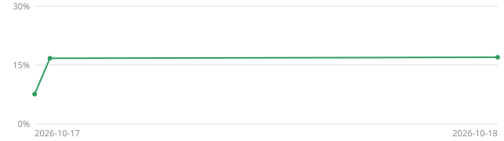

# Progress

**16.98%** of `Tornado.exe`'s code matches byte for byte: 404.0 KB of 2.32 MB, 1,358 of 13,271 functions, 138 units complete.

| | | Matched | Code | Functions |
|---|---|---:|---:|---:|
| All code | `███░░░░░░░░░░░░░░░░░` | 16.98% | 404.0 KB / 2.32 MB | 1,358 / 13,271 |
| Game and engine | `░░░░░░░░░░░░░░░░░░░░` | 0.59% | 7.1 KB / 1.17 MB | 66 / 4,460 |
| Libraries | `████████████████████` | 100.00% | 393.6 KB / 393.6 KB | 1,280 / 1,281 |
| C/C++ runtime | `░░░░░░░░░░░░░░░░░░░░` | 0.00% | 0.0 KB / 155.3 KB | 0 / 716 |
| SDK libraries | `░░░░░░░░░░░░░░░░░░░░` | 0.53% | 3.3 KB / 634.2 KB | 12 / 6,814 |

## Over time

## Units

138 units with source

| Unit | Code | Matched | Complete |
|---|---:|---:|---|
| `Tongas2/FILELOADER` | 0.6 KB | 100.00% | yes |
| `Tongas2/FILELOADERWKZ` | 0.9 KB | 100.00% | yes |
| `Tongas2/SRESULT` | 1.6 KB | 100.00% | yes |
| `Tongas2/SYSMONITOR` | 0.6 KB | 100.00% | yes |
| `Tongas2/TOKENS` | 1.7 KB | 100.00% | yes |
| `Tongas2/WKZ` | 1.6 KB | 100.00% | yes |
| `lib/freeimage/BitmapAccess` | 8.8 KB | 100.00% | yes |
| `lib/freeimage/Conversion` | 0.3 KB | 100.00% | yes |
| `lib/freeimage/Conversion24` | 1.4 KB | 100.00% | yes |
| `lib/freeimage/Conversion32` | 1.6 KB | 100.00% | yes |
| `lib/freeimage/Exif` | 4.4 KB | 100.00% | yes |
| `lib/freeimage/Flip` | 0.2 KB | 100.00% | yes |
| `lib/freeimage/FreeImage` | 0.8 KB | 100.00% | yes |
| `lib/freeimage/FreeImageIO` | 0.4 KB | 100.00% | yes |
| `lib/freeimage/FreeImageTag` | 1.0 KB | 100.00% | yes |
| `lib/freeimage/GetType` | 0.1 KB | 100.00% | yes |
| `lib/freeimage/IPTC` | 1.0 KB | 100.00% | yes |
| `lib/freeimage/MemoryIO` | 0.3 KB | 100.00% | yes |
| `lib/freeimage/NNQuantizer` | 2.9 KB | 100.00% | yes |
| `lib/freeimage/PixelAccess` | 0.6 KB | 100.00% | yes |
| `lib/freeimage/Plugin` | 3.3 KB | 100.00% | yes |
| `lib/freeimage/PluginJPEG` | 4.9 KB | 100.00% | yes |
| `lib/freeimage/PluginPNG` | 3.8 KB | 100.00% | yes |
| `lib/freeimage/Rescale` | 1.4 KB | 100.00% | yes |
| `lib/freeimage/Resize` | 3.3 KB | 100.00% | yes |
| `lib/freeimage/TagLib` | 4.3 KB | 100.00% | yes |
| `lib/freeimage/WuQuantizer` | 6.0 KB | 100.00% | yes |
| `lib/libjpeg/jcapimin` | 0.6 KB | 100.00% | yes |
| `lib/libjpeg/jcapistd` | 0.3 KB | 100.00% | yes |
| `lib/libjpeg/jccoefct` | 1.7 KB | 100.00% | yes |
| `lib/libjpeg/jccolor` | 1.5 KB | 100.00% | yes |
| `lib/libjpeg/jcdctmgr` | 0.6 KB | 100.00% | yes |
| `lib/libjpeg/jchuff` | 2.9 KB | 100.00% | yes |
| `lib/libjpeg/jcinit` | 0.2 KB | 100.00% | yes |
| `lib/libjpeg/jcmainct` | 0.3 KB | 100.00% | yes |
| `lib/libjpeg/jcmarker` | 1.8 KB | 100.00% | yes |
| `lib/libjpeg/jcmaster` | 2.4 KB | 100.00% | yes |
| `lib/libjpeg/jcomapi` | 0.1 KB | 100.00% | yes |
| `lib/libjpeg/jcparam` | 1.4 KB | 100.00% | yes |
| `lib/libjpeg/jcphuff` | 2.5 KB | 100.00% | yes |
| `lib/libjpeg/jcprepct` | 1.2 KB | 100.00% | yes |
| `lib/libjpeg/jcsample` | 2.0 KB | 100.00% | yes |
| `lib/libjpeg/jdapimin` | 1.1 KB | 100.00% | yes |
| `lib/libjpeg/jdapistd` | 0.4 KB | 100.00% | yes |
| `lib/libjpeg/jdcoefct` | 3.1 KB | 100.00% | yes |
| `lib/libjpeg/jdcolor` | 1.3 KB | 100.00% | yes |
| `lib/libjpeg/jddctmgr` | 0.4 KB | 100.00% | yes |
| `lib/libjpeg/jdhuff` | 2.5 KB | 100.00% | yes |
| `lib/libjpeg/jdinput` | 1.3 KB | 100.00% | yes |
| `lib/libjpeg/jdmainct` | 1.5 KB | 100.00% | yes |
| `lib/libjpeg/jdmarker` | 6.2 KB | 100.00% | yes |
| `lib/libjpeg/jdmaster` | 1.1 KB | 100.00% | yes |
| `lib/libjpeg/jdmerge` | 2.6 KB | 100.00% | yes |
| `lib/libjpeg/jdphuff` | 2.8 KB | 100.00% | yes |
| `lib/libjpeg/jdpostct` | 0.3 KB | 100.00% | yes |
| `lib/libjpeg/jdsample` | 1.5 KB | 100.00% | yes |
| `lib/libjpeg/jerror` | 0.3 KB | 100.00% | yes |
| `lib/libjpeg/jfdctfst` | 0.5 KB | 100.00% | yes |
| `lib/libjpeg/jfdctint` | 0.7 KB | 100.00% | yes |
| `lib/libjpeg/jidctfst` | 2.9 KB | 100.00% | yes |
| `lib/libjpeg/jidctint` | 3.0 KB | 100.00% | yes |
| `lib/libjpeg/jmemmgr` | 2.5 KB | 100.00% | yes |
| `lib/libjpeg/jmemnobs` | 0.0 KB | 100.00% | yes |
| `lib/libjpeg/jutils` | 0.1 KB | 100.00% | yes |
| `lib/libpng/png` | 1.5 KB | 100.00% | yes |
| `lib/libpng/pngerror` | 0.6 KB | 100.00% | yes |
| `lib/libpng/pngget` | 0.7 KB | 100.00% | yes |
| `lib/libpng/pngmem` | 0.5 KB | 100.00% | yes |
| `lib/libpng/pngread` | 4.6 KB | 100.00% | yes |
| `lib/libpng/pngrio` | 0.2 KB | 100.00% | yes |
| `lib/libpng/pngrtran` | 14.1 KB | 100.00% | yes |
| `lib/libpng/pngrutil` | 11.4 KB | 100.00% | yes |
| `lib/libpng/pngset` | 4.3 KB | 100.00% | yes |
| `lib/libpng/pngtrans` | 0.7 KB | 100.00% | yes |
| `lib/libpng/pngwio` | 0.2 KB | 100.00% | yes |
| `lib/libpng/pngwrite` | 3.4 KB | 100.00% | yes |
| `lib/libpng/pngwtran` | 1.8 KB | 100.00% | yes |
| `lib/libpng/pngwutil` | 10.3 KB | 100.00% | yes |
| `lib/ode/IceContainer` | 0.3 KB | 100.00% | yes |
| `lib/ode/IceMatrix3x3` | 0.1 KB | 100.00% | yes |
| `lib/ode/IceMatrix4x4` | 0.2 KB | 100.00% | yes |
| `lib/ode/IceOBB` | 0.5 KB | 100.00% | yes |
| `lib/ode/OPC_AABBTree` | 2.0 KB | 100.00% | yes |
| `lib/ode/OPC_BaseModel` | 0.5 KB | 100.00% | yes |
| `lib/ode/OPC_Collider` | 0.1 KB | 100.00% | yes |
| `lib/ode/OPC_LSSCollider` | 0.1 KB | 100.00% | yes |
| `lib/ode/OPC_MeshInterface` | 0.4 KB | 100.00% | yes |
| `lib/ode/OPC_Model` | 0.6 KB | 100.00% | yes |
| `lib/ode/OPC_OBBCollider` | 20.4 KB | 100.00% | yes |
| `lib/ode/OPC_OptimizedTree` | 7.0 KB | 100.00% | yes |
| `lib/ode/OPC_PlanesCollider` | 0.2 KB | 100.00% | yes |
| `lib/ode/OPC_RayCollider` | 11.7 KB | 100.00% | yes |
| `lib/ode/OPC_SphereCollider` | 8.8 KB | 100.00% | yes |
| `lib/ode/OPC_TreeBuilders` | 1.3 KB | 100.00% | yes |
| `lib/ode/OPC_TreeCollider` | 29.5 KB | 100.00% | yes |
| `lib/ode/OPC_VolumeCollider` | 0.5 KB | 100.00% | yes |
| `lib/ode/array` | 0.2 KB | 100.00% | yes |
| `lib/ode/collision_kernel` | 3.3 KB | 100.00% | yes |
| `lib/ode/collision_quadtreespace` | 2.7 KB | 100.00% | yes |
| `lib/ode/collision_space` | 1.8 KB | 100.00% | yes |
| `lib/ode/collision_std` | 18.6 KB | 100.00% | yes |
| `lib/ode/collision_transform` | 1.1 KB | 100.00% | yes |
| `lib/ode/collision_trimesh` | 3.6 KB | 100.00% | yes |
| `lib/ode/collision_trimesh_box` | 10.5 KB | 100.00% | yes |
| `lib/ode/collision_trimesh_ccylinder` | 6.5 KB | 100.00% | yes |
| `lib/ode/collision_trimesh_ray` | 0.8 KB | 100.00% | yes |
| `lib/ode/collision_trimesh_sphere` | 3.1 KB | 100.00% | yes |
| `lib/ode/collision_trimesh_trimesh` | 19.2 KB | 100.00% | yes |
| `lib/ode/collision_util` | 3.8 KB | 100.00% | yes |
| `lib/ode/error` | 0.3 KB | 100.00% | yes |
| `lib/ode/fastdot` | 0.2 KB | 100.00% | yes |
| `lib/ode/fastldlt` | 2.9 KB | 100.00% | yes |
| `lib/ode/fastlsolve` | 1.6 KB | 100.00% | yes |
| `lib/ode/fastltsolve` | 1.3 KB | 100.00% | yes |
| `lib/ode/joint` | 13.1 KB | 100.00% | yes |
| `lib/ode/lcp` | 5.3 KB | 100.00% | yes |
| `lib/ode/mass` | 2.3 KB | 100.00% | yes |
| `lib/ode/matrix` | 5.3 KB | 100.00% | yes |
| `lib/ode/memory` | 0.1 KB | 100.00% | yes |
| `lib/ode/misc` | 0.1 KB | 100.00% | yes |
| `lib/ode/obstack` | 0.4 KB | 100.00% | yes |
| `lib/ode/ode` | 5.2 KB | 100.00% | yes |
| `lib/ode/odemath` | 0.9 KB | 100.00% | yes |
| `lib/ode/quickstep` | 6.2 KB | 100.00% | yes |
| `lib/ode/rotation` | 1.9 KB | 100.00% | yes |
| `lib/ode/step` | 7.1 KB | 100.00% | yes |
| `lib/ode/util` | 1.5 KB | 100.00% | yes |
| `lib/zlib/adler32` | 0.3 KB | 100.00% | yes |
| `lib/zlib/crc32` | 0.6 KB | 100.00% | yes |
| `lib/zlib/deflate` | 4.7 KB | 100.00% | yes |
| `lib/zlib/inffast` | 0.9 KB | 100.00% | yes |
| `lib/zlib/inflate` | 4.8 KB | 100.00% | yes |
| `lib/zlib/inftrees` | 0.9 KB | 100.00% | yes |
| `lib/zlib/trees` | 5.7 KB | 100.00% | yes |
| `lib/zlib/zutil` | 0.0 KB | 100.00% | yes |
| `wt/WTCRYPT` | 0.3 KB | 100.00% | yes |
| `wt/WTLEADERBOARD` | 0.6 KB | 100.00% | yes |
| `wt/WTLEADERBOARDIMPL` | 2.5 KB | 100.00% | yes |

Measured 2026-10-18 13:03 UTC at commit f652c73 with `tools/report.py`; see [docs/maintainers.md](../docs/maintainers.md). Generated by `tools/progress.py`; don't edit by hand.
